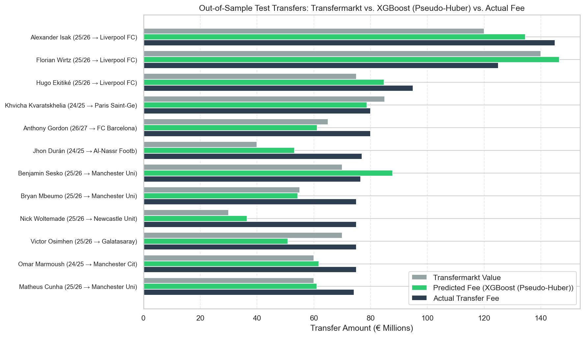
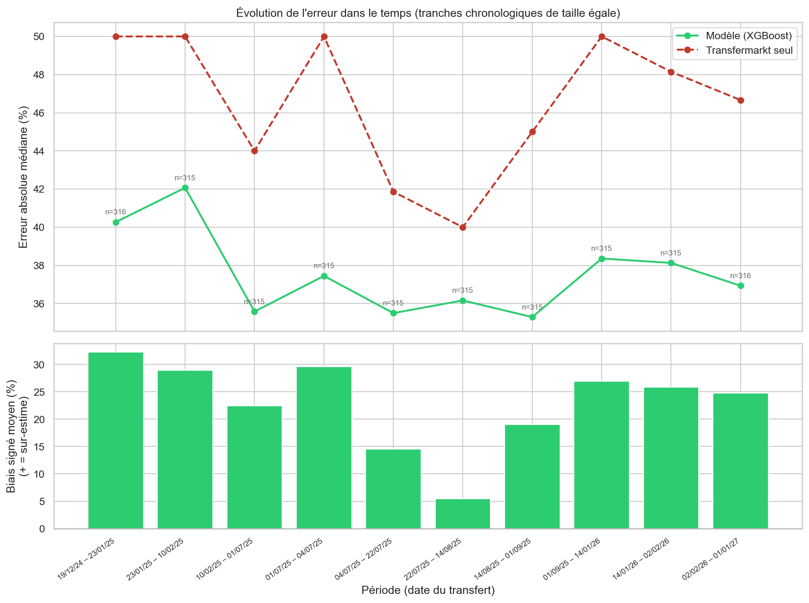

# ⚽ Transfer Fee Prediction — Transfermarkt

Projet de Machine Learning (Edhec) qui tente de répondre à une question simple :
**peut-on prédire le montant réel d'un transfert de football mieux que ne le fait
la valeur marchande Transfermarkt ?**

On modélise le ratio `log(Montant du transfert / Valeur Transfermarkt)` ("spread")
à partir de caractéristiques du joueur, de son historique récent et des clubs
vendeur/acheteur, puis on compare plusieurs modèles (régressions linéaires
régularisées, Random Forest, HistGradientBoosting, LightGBM, XGBoost, CatBoost)
à la simple valeur Transfermarkt prise comme estimation du montant du transfert.

Ce dépôt reprend à l'identique le pipeline développé dans le notebook original
(`players data.ipynb`), réorganisé en modules `.py` pour pouvoir être relancé
facilement et partagé sur Git.

## Résultats en un coup d'œil

| Approche | R² sur log(Montant) | Erreur médiane sur le montant |
|---|---|---|
| Transfermarkt seul | 0.738 | ~47.1 % |
| **XGBoost (meilleur modèle, hyperparamètres tunés)** | **0.825** | **~37.5 %** |

(voir le détail complet, modèle par modèle, dans `outputs/tables/final_fee_comparison.csv`)

Le modèle bat la valeur Transfermarkt sur **~60 % des transferts** du jeu de test
(chronologique, 20 % des transferts les plus récents). Le gain est le plus net
sur les gros transferts (> 15 M€) et les transferts "stars" (> 25 M€).

Toutes les figures sont dans [`outputs/figures/`](outputs/figures) et tous les
tableaux de résultats dans [`outputs/tables/`](outputs/tables), régénérés à
chaque exécution de `main.py`. Exemples :





## Structure du projet

```
.
├── main.py                 # Point d'entrée : exécute tout le pipeline
├── tune_models.py          # Script optionnel : tuning d'hyperparamètres (RandomizedSearchCV)
├── error_analysis.py       # Script optionnel : analyse d'erreurs par segment et dans le temps
├── calibrate_model.py      # Script optionnel : test de calibration isotonique (résultat négatif)
├── src/
│   ├── config.py            # Chemins et constantes
│   ├── data_loading.py      # Chargement + fusion clubs / transfer_panel
│   ├── features.py          # Nettoyage, one-hot encoding, feature engineering
│   ├── eda.py                # Corrélations, distribution de log_spread
│   ├── dataset.py            # Construction de X/y, split train/test chronologique
│   ├── models.py             # Entraînement des modèles (linéaires + arbres/boosting)
│   ├── evaluation.py         # Métriques de régression/classification, diagnostics
│   ├── tier_models.py        # XGBoost par tranche de valorisation vs. modèle global
│   ├── examples.py           # Exemples de transferts du jeu de test, graphiques finaux
│   ├── tuning.py             # Grilles de recherche + comparaison baseline/tuné/benchmark
│   ├── error_analysis.py     # Segmentation de l'erreur (position/âge/championnat/temps)
│   └── calibration.py        # Calibration isotonique XGBoost (fit/calib/test chronologiques)
├── outputs/
│   ├── figures/              # PNG générés par le pipeline
│   └── tables/                # CSV des tableaux de résultats
├── transfermarkt data/       # Données (voir ci-dessous)
├── players data.ipynb         # Notebook original (exploration)
└── requirements.txt
```

## Installation

```bash
python3 -m venv .venv
source .venv/bin/activate
pip install -r requirements.txt
```

## Données

Le pipeline a besoin de 3 fichiers dans `transfermarkt data/` :

- `clubs.csv` et `players.csv` — issus du dataset Kaggle
  [davidcariboo/player-scores](https://www.kaggle.com/datasets/davidcariboo/player-scores)
  (données Transfermarkt).
- `transfer_panel.csv` — un **panel de features déjà construit** (un transfert
  par ligne : fee, valeur marchande, historique du joueur sur 12 mois,
  caractéristiques des clubs vendeur/acheteur, etc.) à partir de ce même
  dataset. C'est le fichier d'entrée principal du pipeline.

Ces trois fichiers sont inclus dans le dépôt (ils ne pèsent que quelques
dizaines de Mo au total). Les autres fichiers bruts de `transfermarkt data/`
(appearances, game_events, game_lineups, transfers, valuations...) ne sont
**pas utilisés** par ce pipeline et sont exclus du dépôt (voir `.gitignore`) —
ils peuvent être retéléchargés via `kagglehub.dataset_download("davidcariboo/player-scores")`
si besoin pour reconstruire `transfer_panel.csv` à partir de zéro.

## Lancer le projet

```bash
python main.py
```

Le script affiche la progression dans la console, puis écrit :
- les figures dans `outputs/figures/*.png`
- les tableaux de résultats dans `outputs/tables/*.csv`

Temps d'exécution : quelques minutes sur un ordinateur portable (le jeu de
données fait ~17 000 transferts avec un montant connu).

## Méthodologie (résumé)

1. **Préparation** : fusion des transferts avec les informations des clubs
   vendeur/acheteur, récupération de la valeur marchande au transfert
   précédent, filtrage des transferts avec montant connu.
2. **Feature engineering** : encodage one-hot (poste, pied, championnat,
   confédération), variables dérivées (spread, momentum de valorisation,
   indicateurs de comparaison entre clubs), nettoyage du "net transfer record".
3. **Split chronologique** 80/20 (entraînement sur les transferts les plus
   anciens, test sur les plus récents) pour éviter toute fuite d'information
   dans le temps.
4. **Modélisation** : régressions régularisées (Ridge, ElasticNet, Huber) et
   modèles d'arbres/boosting (Random Forest, HistGradientBoosting, LightGBM,
   XGBoost, CatBoost), plus un blend Ridge/GBDT.
5. **Évaluation** : MAE/RMSE/R² sur `log_spread`, classification binaire
   (prime vs. décote par rapport à la valeur Transfermarkt), erreur en € sur
   le montant final, et analyse par tranche de valorisation du joueur.

## Tuning des hyperparamètres (optionnel)

[`tune_models.py`](tune_models.py) lance un `RandomizedSearchCV` (avec un
`TimeSeriesSplit`, pas un K-Fold classique, pour rester cohérent avec le split
chronologique) sur XGBoost, LightGBM, HistGradientBoosting et RandomForest, puis
vérifie le gain sur le jeu de test chronologique — jamais utilisé pendant la
recherche — pour s'assurer qu'il tient vraiment "out of sample" et n'est pas un
artefact du cross-validation.

```bash
python tune_models.py --n-iter 25
```

Résultat : gain confirmé out-of-sample pour XGBoost, HistGradientBoosting et
RandomForest (déjà intégré dans `src/models.py`) ; pas de gain pour LightGBM,
dont les hyperparamètres d'origine ont donc été conservés. Le gain reste modeste
dans l'absolu — la vraie différence de performance est entre "un modèle ML" et
"Transfermarkt seul", pas entre "tuné" et "pas tuné" (voir
[`outputs/figures/tuning_vs_benchmark.png`](outputs/figures/tuning_vs_benchmark.png)
et [`outputs/figures/xgboost_hyperparam_evolution.png`](outputs/figures/xgboost_hyperparam_evolution.png)).

## Analyse d'erreurs (optionnel)

[`error_analysis.py`](error_analysis.py) va plus loin que la segmentation par
tranche de valorisation du pipeline principal : il regarde où et quand le
meilleur modèle (XGBoost) se trompe le plus, par **position**, **âge**,
**championnat du club acheteur**, **saison du transfert**, et par **tranche
chronologique** — avec à chaque fois l'ampleur de l'erreur *et* le biais
directionnel (sur- ou sous-estimation systématique, pas juste l'erreur absolue).

```bash
python error_analysis.py
```

Principaux constats :
- Le modèle **sur-estime systématiquement** les montants, à des degrés très
  différents selon le championnat : **+50.8%** pour La Liga (ES1) contre
  seulement **+8.5%** pour la Premier League (GB1) — cohérent avec les
  contraintes financières connues des clubs espagnols (Fair-Play Financier).
- Les **gardiens** (+45.7%) et les **moins de 21 ans** (+26.4%) sont aussi
  nettement plus sur-estimés que la moyenne.
- Dans le temps, l'erreur est **stable** sur les ~2 ans du jeu de test : le
  modèle bat Transfermarkt seul sur **chaque** tranche chronologique, sans
  exception — l'avantage n'est pas un coup de chance concentré sur une période.



**Piste testée et abandonnée** : [`calibrate_model.py`](calibrate_model.py)
essaie de corriger ce biais avec une régression isotonique (prédiction brute →
valeur corrigée), apprise sur une portion du train set jamais utilisée pour
l'entraînement. Résultat **négatif** : la correction aggrave le biais sur le
test set, car le biais mesuré n'est pas stable dans le temps (la fenêtre de
calibration et le test set n'ont pas le même biais). Conservé dans le dépôt
comme exemple de vérification out-of-sample qui a bien fait son travail —
mieux vaut un résultat négatif détecté que des faux espoirs.

## Notebook original

Le notebook `players data.ipynb` reste disponible dans le dépôt pour
l'exploration interactive — le code de `src/` en est une traduction fidèle,
sans changement de logique ni de paramètres.
